# CarePaw — App Flowchart (Diagram + Story)

> The diagram uses everyday words only. The story below it names each screen
> the way the app code calls it (screen name + page address), so you can match
> story → diagram → app.

---

## The diagram (plain words — nothing technical)

```mermaid
flowchart TD
    Logo["Opening screen\n(app logo, loading)"]
    Login["Login screen\n(email + password)"]
    Create["Create account screen\n(new pet owner joins)"]
    Forgot["Forgot password screen\n(reset by email)"]

    Logo --> Login
    Login --> Create
    Login --> Forgot
    Create --> Login

    Login --> OwnerHome["Owner Home\n(my pets + upcoming visits)"]
    Login --> DeskHome["Front Desk Home\n(today's numbers + line preview)"]
    Login --> DoctorHome["Doctor Home\n(patients + visit notes)"]
    Login --> ManagerHome["Manager Home\n(accounts + activity history)"]

    OwnerHome --> PetList["My Pets list"]
    PetList --> AddPet["Add a pet"]
    PetList --> PetInfo["Pet details"]
    PetInfo --> EditPet["Edit pet"]

    OwnerHome --> BookingList["My Bookings list"]
    BookingList --> BookVisit["Book a visit"]
    BookingList --> BookingInfo["Booking details"]
    BookingInfo --> EditBooking["Change booking"]

    BookingInfo --> MyLine["My place in line"]
    OwnerHome --> MyLine

    PetInfo --> HealthHistory["Pet health history"]
    OwnerHome --> HealthHistory
    HealthHistory --> VisitInfo["Visit details\n(read-only)"]

    DeskHome --> AllBookings["All bookings\n(every owner)"]
    AllBookings --> BookingInfo
    AllBookings --> WalkIn["Add walk-in visitor"]
    WalkIn --> RunLine["Run the waiting line"]

    DeskHome --> RunLine
    RunLine --> CallNext["Call next → in room → done"]

    DeskHome --> StockList["Medicine stock list"]
    StockList --> StockInfo["Stock item details\n(batches + history)"]
    StockInfo --> StockIn["Receive new delivery"]
    StockInfo --> StockOut["Give out medicine"]
    StockList --> AddStock["Add new stock item"]

    DeskHome --> ScanList["Scan list"]
    ScanList --> Camera["Camera scan\n(medicine box / receipt)"]
    Camera --> ScanCheck["Check + confirm scan\n(person approves)"]

    DoctorHome --> PatientList["Patient list\n(all pets)"]
    PatientList --> PatientInfo["Patient details + history"]
    PatientInfo --> NewNote["New visit note"]
    PatientInfo --> NewVaccine["Add vaccine"]
    PatientInfo --> NewMedicine["Medicine instructions\n(doctor only)"]
    DoctorHome --> RunLine

    ManagerHome --> Accounts["Accounts list\n(owners + workers + doctors)"]
    Accounts --> AddAccount["Add account"]
    Accounts --> EditAccount["Change type / on-off"]
    ManagerHome --> ActivityHistory["Activity history\n(who did what, when)"]
    ManagerHome --> ClinicSettings["Clinic settings"]

    OwnerHome --> Messages["Messages"]
    DeskHome --> Messages
    DoctorHome --> Messages
    ManagerHome --> Messages
    Messages --> MessageInfo["Message details"]

    OwnerHome --> Profile["My Profile"]
    DeskHome --> Profile
    DoctorHome --> Profile
    ManagerHome --> Profile
```

---

## The story behind the diagram (lightly technical — screen by screen)

Each item names the screen (`Page` widget, page address like `/login`) the
first time it appears, then tells the story in plain words.

### Opening screens

- **Opening screen** — `_SplashPage` at `/`. Shows the logo, checks whether
  you are already logged in (`AuthCheckRequested`), then sends you to Login
  or straight to your home screen.
- **Login screen** — `LoginPage` at `/login`. Email + password boxes. Logging
  in sends you to one of four homes depending on your account type (owner →
  `/home`, front desk → `/staff`, doctor → `/vet`, manager → `/admin`).
- **Create account screen** — `RegisterPage` at `/register`. Only creates pet
  owner accounts (the app always saves `role = petOwner` here). Worker and
  doctor accounts are created later by the manager.
- **Forgot password screen** — `ForgotPasswordPage` at `/forgot-password`
  plus `ResetPasswordPage` at `/reset-password?token=`. You type your email,
  open the link it sends you, set a new password, and return to Login.

### Owner side (home at `/home`, `HomePage`)

- **Owner Home** — greeting, pet photo row, upcoming visits, big "Book
  appointment" card, quick links. Its buttons open: Book a Visit
  (`/appointments/request`), a pet's details (`/pets/:id`), My Bookings
  (`/appointments`), My Line (`/queue`), Health History
  (`/medical-records?petId=`), and Messages (`/notifications`).
- **My Pets list** — `PetListPage` at `/pets`. Shows only your pets.
- **Add a pet** — `PetFormPage` at `/pets/add`. Name, animal type, breed,
  birthday, photo → Save returns to the list with the pet added.
- **Pet details** — `PetDetailPage` at `/pets/:id`. Full info plus jumps to
  bookings and health history.
- **Edit pet** — same form at `/pets/:id/edit`. Save returns to details.
- **My Bookings list** — `AppointmentListPage` at `/appointments`. Upcoming
  first with status labels (waiting for approval, confirmed, done,
  cancelled).
- **Book a visit** — `AppointmentFormPage` at `/appointments/request`. Pick
  pet, doctor, day, time, reason → new booking appears as "waiting."
- **Booking details** — `AppointmentDetailPage` at `/appointments/:id`.
  Shows one booking; on visit day it offers Check In.
- **Change booking** — the same form at `/appointments/:id/edit`. Edit
  day/time/reason or cancel (always asks "are you sure?" first).
- **My place in line** — `QueuePage` at `/queue`. Your number, who's ahead,
  who's being served. Updates by itself while the clinic runs the line; a
  Check In button appears here if you haven't checked in yet.
- **Pet health history** — `MedicalRecordListPage` at
  `/medical-records?petId=` (needs a pet picked, otherwise a "pet required"
  placeholder shows). Newest visits first.
- **Visit details (read-only)** — `MedicalRecordDetailPage`. Old notes can
  never be edited; corrections appear as new notes on top.

### Front desk side (home at `/staff`, `StaffDashboardPage`)

- **Front Desk Home** — today's counts (waiting / in room / now serving),
  live line preview, and shortcut buttons to every work screen below.
- **All bookings** — the same `AppointmentListPage` at `/staff/appointments`,
  but showing every owner's bookings. Confirm, suggest a new time, reject,
  check in, or add a walk-in visitor with no booking.
- **Run the waiting line** — `StaffQueuePage` at `/staff/queue`. The full
  ordered line with confirm popups: call next, move to room, finish, skip.
  Each tap updates every phone in the clinic at once.
- **Medicine stock list** — `InventoryListPage` at `/staff/inventory`.
  Every item with count left; low stock is flagged.
- **Stock item details** — `InventoryDetailPage` (opened directly on top,
  no page address). Batches with expiry dates plus the full in/out history.
- **Receive / Give out** — actions inside Stock Details: new delivery
  arrived, medicine used for a patient, or fix a wrong count (asks for a
  reason).
- **Add new stock item** — `InventoryFormPage` (opened directly). Save
  returns to the list.
- **Scan list** — `ScanListPage` at `/staff/scanning`. Past scans.
- **Camera scan** — `ScanCameraPage` (opened directly). Point at a medicine
  box or receipt; the app reads the text into the boxes.
- **Check + confirm scan** — `ScanDetailPage` (opened directly). A person
  must approve before saving — the machine reading is never saved alone.

### Doctor side (home at `/vet`, `VetDashboardPage`)

- **Doctor Home** — shortcut buttons: new visit note, medicine instructions,
  add vaccine, patient history.
- **Patient list** — `PetListPage` at `/vet/patients`. All pets, searchable.
- **Patient details + history** — `PetDetailPage` at `/vet/patients/:id`.
  Full history, vaccines, current medicine.
- **New visit note** — `MedicalRecordFormPage`. Findings, diagnosis,
  treatment, follow-up date → saved forever (uncorrectable except by a new
  note).
- **Add vaccine** — vaccine screen: name, date given, next due date.
- **Medicine instructions (doctor only)** — the prescription screen. Name,
  amount, how often, how many days. The Save button on this screen appears
  for the doctor account only — this lock is intentional for safety.

### Manager side (home at `/admin`, `AdminDashboardPage`)

- **Manager Home** — entry buttons to Accounts, Activity History, Settings.
- **Accounts list** — `AdminUserManagementPage` at `/admin/users`. Everyone:
  owners, workers, doctors. Search + filter by account type.
- **Add account** — inside the Accounts screen: pick type (owner / worker /
  doctor — never manager), fill in details, create.
- **Change type / on-off** — tap a person: change their account type or
  switch the account off when someone leaves.
- **Activity history** — `AdminAuditPage` at `/admin/audit`. Newest first:
  when, who, what (logins, approvals, visit notes, stock changes, account
  changes). Read-only — nobody can edit or delete it.
- **Clinic settings** — `AdminSettingsPage` at `/admin/settings`. Clinic
  name, hours, line rules, message texts. Save applies clinic-wide.

### Shared by everyone

- **Messages** — `NotificationListPage` at `/notifications`. Booking
  confirmations, "you're next," medicine ready, reminders. Includes mark-all-
  read and a settings page for which reminders you want.
- **Message details** — `NotificationDetailPage` (opened directly). One
  message with its full text; can mark read or delete.
- **My Profile** — `ProfilePage` at `/profile`. Name, contact info, account
  type badge. Edit your info, or log out (asks first).

---

### Bottom buttons (who sees what)

| Who logs in | Buttons at the bottom |
|---|---|
| Pet Owner | Home · Pets · Bookings · Line · Profile |
| Front Desk | Home · Bookings · Line · Stock · Scan · Profile |
| Doctor | Home · Patients · Records · Line · Profile |
| Manager | Home · Accounts · History · Profile |

Everyone reaches Messages through the bell icon on their home screen.

---

*Companion: `SYSTEM_WORKFLOW.md` — the story of one full clinic day
(Lina and Bingo) in plain words.*
