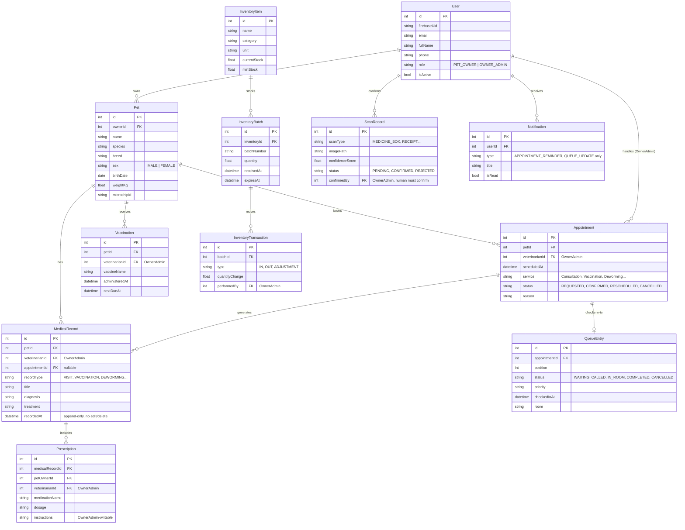

# CarePaw ERD - Paper-Matched (Plain Words + Mermaid)

> Client: DocMyk's PILA VET HUB, Pila, Laguna
> Paper: 2 sides only (Pet Owner + Owner/Admin), 4 jobs.
> This diagram removes old roles (VET/STAFF/ADMIN) and out-of-scope extras
> (AuditLog, user management, sync tables) so code matches Chapter 1.

## In plain words

- One **User** is either a **Pet Owner** or the single **Owner/Admin** who does
  counter + vet + boss work.
- An **Owner** owns many **Pets**. Each pet has sex, breed, weight.
- An **Appointment** is a booking for one pet, handled by the Owner/Admin
  (service picker: Consultation, Vaccination, Deworming...).
- A **QueueEntry** is the live waiting line for that appointment
  (waiting / called / in-room / done / cancelled).
- A **MedicalRecord** is the visit note (append-only, correction-note on top),
  plus **Vaccination** and **Prescription** (medicine instructions).
- **InventoryItem -> Batch -> Transaction** is the medicine stock.
- A **ScanRecord** is a camera scan of a box/receipt - machine never trusted
  alone, Owner/Admin must confirm.
- **Notification** is paper-only: appointment + queue messages.

## Mermaid

## What was removed to match paper

- Roles `VETERINARIAN`, `STAFF`, `ADMIN` deleted. Only `PET_OWNER` + `OWNER_ADMIN`.
- Collections hidden from diagram: `auditLogs`, `users` management screens,
  `syncMetadata`, `deviceInfo`, `syncConflicts`, `counters`,
  `notificationPreferences`.
- Old `/staff`, `/vet`, `/admin` routes not shown - reserve only, gated to Owner/Admin.
